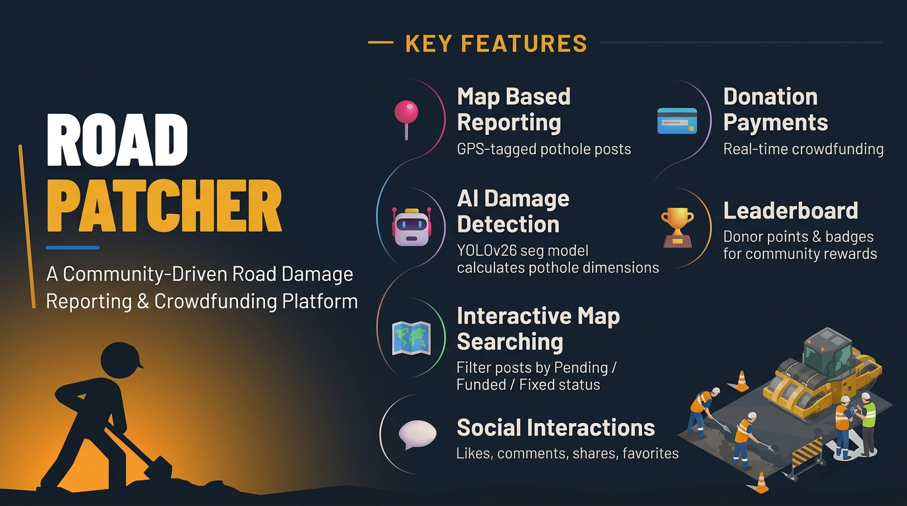
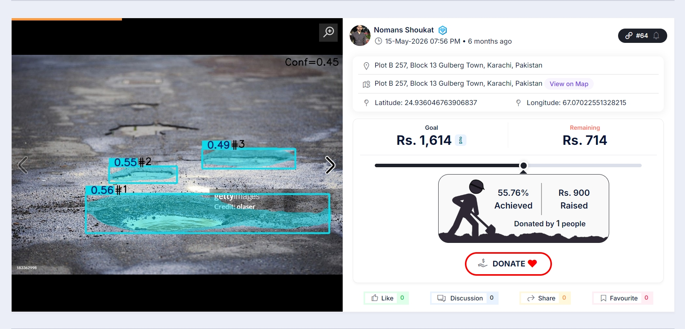

# Road Patchers

**Community-driven road repair crowdfunding platform**

Citizens report damaged roads with photo/video evidence and a precise location, administrators review each report (optionally running an AI pothole-detection model on the photo), and the community funds the repair through secure card donations — with real-time progress, notifications, and full transparency from report to completion.





> 📸 **More visuals:** browse the [`screenshots/`](screenshots/) folder for the full tour — authentication & 2FA, post feeds, donations, discussions, map search, notifications, leaderboard, the admin portal, and the ERD.

---

## Table of Contents

- [Key Features](#key-features)
- [Tech Stack](#tech-stack)
- [Architecture](#architecture)
- [How It Works](#how-it-works)
- [Getting Started](#getting-started)
- [Existing Accounts](#existing-accounts)
- [Configuration](#configuration)
- [Roles & Permissions](#roles--permissions)
- [Project Structure](#project-structure)

---

## Key Features

### Reporting & Review
- **Damage reports** with a required image and video, optional extra media (images/videos), description, and camera parameters used for measurement.
- **Precise geolocation** via Google Maps — device geolocation, address geocoding, Places autocomplete, and a draggable marker — restricted to locations inside Pakistan.
- **Review workflow** — new posts start as `InReview` and are auto-assigned to the **least-loaded Admin**. Reviewers can *Approve*, *Request Changes* (with a comment), or *Reject*. Owners can edit and resubmit when changes are requested.
- **AI pothole measurement** — reviewers can run a custom-trained **YOLO26 segmentation model** on the post image. It returns an annotated image plus the estimated area (cm²) of each detected pothole, computed from the image EXIF focal length and the reported camera height/distance. Results are saved with the post.

### Crowdfunding
- **Stripe PaymentIntents** (PKR, card) with server-side validation: minimum **Rs. 200**, maximum = remaining goal.
- **Verified confirmation** — every payment is re-fetched from Stripe before being recorded; a unique index on `PaymentIntentId` makes confirmation idempotent, and the donation + post totals are written in a single transaction.
- **Automatic status flow** — `Pending` → `InProcess` when fully funded → `Completed` once an Admin uploads a completion image.
- **Live progress** — raised/remaining amounts, donor count, and a color-coded progress bar update in place after a donation.

### Discovery
- **Feeds**: Pending, In Process, Completed, Favourited, and Donated — all **sorted by distance** from the user's profile location using PostGIS.
- **Keyword search** across description, address, and Google address.
- **Advanced search** by keyword, radius around a point, goal / raised / remaining ranges, funding percentage, donor count, creators, and status.
- **Map search** — markers load dynamically for the visible viewport and are color-coded by status, with status/user filters.

### Community & Engagement
- **Threaded discussions** (unlimited nesting) with admin comments highlighted and pinned first.
- **Likes, favourites, and social sharing** (Shareon) with per-post counters.
- **Per-post notification subscriptions** — owners and assigned reviewers are subscribed automatically; anyone can follow or unfollow a post.
- **Real-time notifications** over SignalR (toast pop-ups + unread badge), plus a notifications page with search, label filter, and read/unread management.
- **Contributor badges & leaderboard** — lifetime donations unlock tiered SVG badges:

  | Badge | Lifetime donations |
  |---|---|
  | Bronze | ≥ Rs. 1,000 |
  | Silver | ≥ Rs. 5,000 |
  | Gold | ≥ Rs. 10,000 |
  | Platinum | ≥ Rs. 25,000 |
  | Emerald | ≥ Rs. 50,000 |
  | Diamond | ≥ Rs. 100,000 |

### Accounts & Security
- ASP.NET Core Identity with **email confirmation** (SMTP), password reset, and **authenticator-app 2FA** with recovery codes.
- **Social sign-in** with Google, Facebook, and X (Twitter) — each provider is enabled only when its keys are configured.
- **Profile completion gate** — users must save a profile (name, address, map location) before browsing the post feeds.
- Disabled (locked-out) accounts are signed out automatically on their next request.
- User IDs always come from server-side claims; anti-forgery tokens protect form posts.

### Admin Portal
- **Dashboard** with quick links for admins.
- **Post management** — "My Posts", "Review Posts" (assigned to me), and "All Posts" (SuperAdmin) with search and status/creator filters.
- **User management** — search, filter by role, create/edit users, assign roles (SuperAdmin only), and enable/disable accounts.
- **Regional statistics** — draw a polygon on the map to get the posts inside it, status counts, total raised vs. goal, top donors, and recent donations.

---

## Tech Stack

| Layer | Technologies |
|---|---|
| **Backend** | ASP.NET Core 10 (MVC + Razor Pages), C# |
| **Data** | PostgreSQL + **PostGIS**, Entity Framework Core 10 (code-first), Npgsql, NetTopologySuite |
| **Auth** | ASP.NET Core Identity, Google / Facebook / X OAuth, TOTP 2FA (QRCoder) |
| **Payments** | Stripe.net + Stripe.js (PaymentIntents) |
| **Real-time** | SignalR |
| **AI / ML** | Python, Ultralytics YOLO26 (segmentation), OpenCV, NumPy, Pillow — called from .NET via **CSnakes** |
| **Frontend** | Razor views, Bootstrap-based admin theme (KeenThemes), jQuery, Axios, Toastr, Swiper, FSLightbox, jquery-comments, Shareon |
| **Maps** | Google Maps JavaScript API (Places, Geocoding, Drawing) |
| **Other** | X.PagedList (pagination), Newtonsoft.Json (snake_case API responses), SMTP email |

---

## Architecture

```
RoadPatcher.sln
├── RoadPatcher.Application   Class library: entities, DbContext, Fluent API configs, EF migrations
├── RoadPatcher.Web           ASP.NET Core app: controllers, Razor views, Admin & Identity areas,
│                             middleware, services, SignalR hub, static assets
└── RoadPatcher.AIML          Python ML project (CSnakes): YOLO26 inference (predict.py) + training scripts
```

**Request pipeline:** HTTPS redirection → static files → routing → authentication → **ProfileCompletionMiddleware** → authorization → ThemeMiddleware → status-code pages (`/Error/{code}`).

**Spatial data:** posts store latitude/longitude and expose a `geography(point)` column (SRID 4326) with a **GIST index**. Feeds sort with `ST_Distance`, advanced search filters with `ST_DWithin`, and map search and statistics use `ST_Intersects` against the viewport or drawn polygon.

**Core entities:** `ApplicationUser`, `UserData` (profile, location, badge), `Post`, `Media`, `Donation`, `Comment` (self-referencing), `Like`, `Favourite`, `Share`, `Notification`, `PostNotificationSubscription`.

---

## How It Works

```
 Citizen                     Admin / Reviewer                       Community
 ───────                     ────────────────                       ─────────
 Create post  ──►  InReview ──► (optional) run AI inference
 (image, video,               ──► set repair goal
  location)                   ──► Approve / Request changes / Reject
                                        │
                                        ▼
                               Approved · Pending  ──────────────►  Donate via Stripe
                                                                     (Rs. 200 … remaining)
                                        │  goal reached
                                        ▼
                                    InProcess  ──► upload completion image ──► Completed
```

Every step notifies the relevant people (owner, reviewer, post subscribers, SuperAdmin) in real time.

---

## Getting Started

### Prerequisites

- [.NET 10 SDK](https://dotnet.microsoft.com/download)
- PostgreSQL with the **PostGIS** extension available
- Python **3.10** (for AI inference) — see [AI setup](#4-ai-inference-setup)
- API credentials: Google Maps, Stripe (test mode is fine), an SMTP account, and optionally Google/Facebook/X OAuth apps

### 1. Clone

```bash
git clone <repository-url>
cd RoadPatcher
```

### 2. Configure

Fill in `RoadPatcher.Web/appsettings.json` (see [Configuration](#configuration)). For local development, prefer [user secrets](https://learn.microsoft.com/aspnet/core/security/app-secrets) over committing keys:

```bash
cd RoadPatcher.Web
dotnet user-secrets init
dotnet user-secrets set "Stripe:SecretKey" "sk_test_..."
```

### 3. Create the database

The migrations enable the `postgis` extension automatically. Your database user needs permission to create it.

```bash
dotnet tool install --global dotnet-ef   # if not already installed

dotnet ef database update \
  --project RoadPatcher.Application \
  --startup-project RoadPatcher.Web
```

### 4. AI inference setup

The web app starts an embedded Python runtime through CSnakes. It expects a virtual environment at `RoadPatcher.AIML/.venv` and uses the `PYTHONHOME` environment variable to find Python 3.10.

```bash
cd RoadPatcher.AIML
python -m venv .venv
# Windows: .venv\Scripts\activate    macOS/Linux: source .venv/bin/activate
pip install -r requirements.txt
```

Place the trained segmentation weights at:

```
RoadPatcher.AIML/output/d40_yolo26_seg_model/weights/best.pt
```

> The `output/` folder is git-ignored, so the weights are not in the repository. You can train your own model with `train.py`, which fine-tunes `yolo26s-seg.pt` on a pothole polygon dataset.

### 5. Run

```bash
dotnet run --project RoadPatcher.Web
```

The app runs at `https://localhost:7089` by default. Startup creates the `SuperAdmin`, `Admin`, and `User` roles.

### 6. Create the first SuperAdmin

New accounts get the `User` role. Register an account, confirm the email, then promote it in the database:

```sql
-- Replace the email with your account's
DELETE FROM "AspNetUserRoles"
WHERE "UserId" = (SELECT "Id" FROM "AspNetUsers" WHERE "Email" = 'you@example.com');

INSERT INTO "AspNetUserRoles" ("UserId", "RoleId")
SELECT u."Id", r."Id"
FROM "AspNetUsers" u, "AspNetRoles" r
WHERE u."Email" = 'you@example.com' AND r."Name" = 'SuperAdmin';
```

Sign out and back in. You can now create Admins from **Users** in the admin portal.

> A SuperAdmin account is required: notifications and review assignment both use it.

---

## Existing Accounts

Use these accounts to sign in to the existing system and try each role:

| Role | Email | Password |
|---|---|---|
| SuperAdmin | `superadmin@gmail.com` | `@dmiN0m!` |
| Admin | `admin@gmail.com` | `@dmiN0m!` |
| Admin | `admin2@gmail.com` | `@dmiN0m!` |
| User | `nomanaadma@gmail.com` | `@dmiN0m!` |

> These accounts exist in the project's current database. A fresh install starts with an empty database, so follow [step 6](#6-create-the-first-superadmin) to create your own SuperAdmin.

---

## Configuration

`RoadPatcher.Web/appsettings.json`:

```json
{
  "ConnectionStrings": {
    "DefaultConnection": "Server=localhost;Port=5432;Database=roadpatcher;User ID=postgres;Password=<password>;"
  },
  "Paging": {
    "PageSize": 5,
    "UsersPageSize": 10,
    "NotificationsPageSize": 10
  },
  "GoogleMaps": {
    "ApiKey": "<google-maps-api-key>"
  },
  "Stripe": {
    "SecretKey": "sk_test_<...>",
    "PublishableKey": "pk_test_<...>"
  },
  "Authentication": {
    "Google":   { "ClientId": "<id>", "ClientSecret": "<secret>" },
    "Facebook": { "AppId": "<id>",    "AppSecret": "<secret>" },
    "X":        { "ClientId": "<consumer-key>", "ClientSecret": "<consumer-secret>" }
  },
  "EmailSettings": {
    "Sender": "<smtp-username>",
    "Password": "<smtp-app-password>",
    "Host": "smtp.gmail.com",
    "Port": 587
  }
}
```

| Key | Purpose |
|---|---|
| `ConnectionStrings:DefaultConnection` | PostgreSQL/PostGIS connection (required) |
| `Paging:*` | Page sizes for post feeds, admin user list, and notifications |
| `GoogleMaps:ApiKey` | Maps, Places, Geocoding, and Drawing libraries |
| `Stripe:SecretKey` / `PublishableKey` | Server- and client-side Stripe keys |
| `Authentication:*` | OAuth providers. Leave a provider's values empty to disable it |
| `EmailSettings:*` | SMTP (SSL) used for confirmation and password-reset emails |

**Google Maps:** enable the *Maps JavaScript API*, *Places API*, and *Geocoding API*.
**OAuth callbacks:** `/signin-google`, `/signin-facebook`, and `/signin-twitter`.

---

## Roles & Permissions

| Capability | User | Admin | SuperAdmin |
|---|:-:|:-:|:-:|
| Browse, search, donate, comment, like, share | ✅ | ✅ | ✅ |
| Create posts | ✅ (sent for review) | ✅ (sent for review) | ✅ (approved automatically) |
| Set a post's funding goal | — | ✅ | ✅ |
| Review assigned posts, run AI inference | — | ✅ | ✅ (any post) |
| Mark funded posts as completed | — | ✅ | ✅ |
| Regional statistics, user list, enable/disable users | — | ✅ | ✅ |
| Manage Admin accounts and assign roles, view all posts | — | — | ✅ |

---

## Project Structure

```
RoadPatcher.Application/
  Entities/                 Domain models and enums (PostStatus, ApprovalStatus, DonationStatus)
  Data/ApplicationDbContext.cs
  Data/Configurations/      Fluent API configurations (GIST index, relations, defaults)
  Data/Migrations/          EF Core migrations

RoadPatcher.Web/
  Controllers/              Posts, Donations, Comments, Notifications, Leaderboard, Settings, Error
  Areas/Admin/              Dashboard, Users, Statistics
  Areas/Identity/           Customized Identity pages (login, register, external login, 2FA)
  Hubs/NotificationHub.cs   SignalR hub (/hubs/notification)
  Services/                 NotificationService, ContributionService (badges/leaderboard), EmailSender
  Middlewares/              ProfileCompletionMiddleware, ThemeMiddleware
  Helpers/                  Post, Currency (PKR), Date, User, Comment, Contribution helpers
  Views/                    Razor views and layouts
  wwwroot/js/               main.js (search, map, statistics), post.js, post-form.js, notification-hub.js

RoadPatcher.AIML/
  predict.py                Inference: segmentation + ground-plane area estimation
  train.py                  YOLO26 segmentation training script
  requirements.txt
```

Uploaded files are saved to `RoadPatcher.Web/wwwroot/uploads/posts/` and `.../uploads/users/` (git-ignored, created when first needed).
